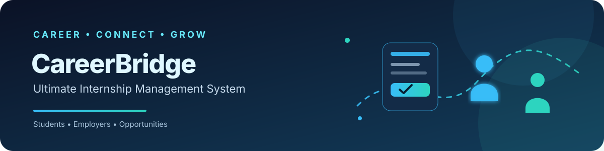
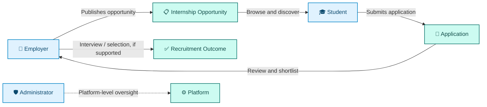

<!-- CareerBridge README | animated banner is stored in assets/careerbridge-banner.svg -->
<p align="center">
  
</p>

<p align="center">
  <a href="https://github.com/MominurIslamRoby/CareerBridge"></a>
  
  
</p>

<p align="center">
  <strong>A centralized platform concept for connecting students with employers and managing internship opportunities.</strong>
</p>

<p align="center">
  <a href="#-overview">Overview</a> •
  <a href="#-features">Features</a> •
  <a href="#-workflow">Workflow</a> •
  <a href="#-getting-started">Setup</a> •
  <a href="#-developer">Developer</a>
</p>

---

## 🎯 Overview

**CareerBridge — Ultimate Internship Management System** is a web-based academic project intended to organize the internship discovery and recruitment process in one place.

The project is designed around three roles:

- 🎓 **Student** — discovers opportunities and follows application progress.
- 🏢 **Employer** — publishes opportunities and reviews applicants.
- 🛡️ **Administrator** — oversees user accounts and platform-level information.

> **Implementation note:** This README documents the project scope. A feature should be considered implemented only when it is present in the current source code. Exact libraries, database tables, and configuration should be confirmed from the project files.

## ✨ Features

<table>
  <tr>
    <td width="33%" valign="top">
      <h3>🎓 Student</h3>
      <ul>
        <li>Browse internship and job opportunities</li>
        <li>View opportunity details</li>
        <li>Submit applications</li>
        <li>Track application status</li>
      </ul>
    </td>
    <td width="33%" valign="top">
      <h3>🏢 Employer</h3>
      <ul>
        <li>Maintain employer/company information</li>
        <li>Publish and manage opportunities</li>
        <li>Review submitted applications</li>
        <li>Shortlist candidates</li>
        <li>Manage interview and selection details where supported</li>
      </ul>
    </td>
    <td width="33%" valign="top">
      <h3>🛡️ Administrator</h3>
      <ul>
        <li>Manage user accounts</li>
        <li>Oversee platform information</li>
        <li>Manage announcements, notifications, or reports where implemented</li>
      </ul>
    </td>
  </tr>
</table>

## 🔄 Workflow

The diagram below shows the **intended** high-level workflow, not a guarantee that every step is already implemented.



## 🎨 Visual Design

The README includes a custom CareerBridge banner, section icons, status badges, and a Mermaid workflow diagram to make the project overview easier to scan.

The banner SVG includes subtle motion effects. **Animated SVG behavior depends on the renderer**; GitHub may sanitize or display some SVG animation differently. GitHub README files do not execute embedded CSS or JavaScript, so interactive page behavior must live in the application itself.

Potential application UI elements include:
- 🧭 Navigation and role-specific menus
- 🗂️ Opportunity cards and detail views
- 🔎 Search and filter controls
- 📝 Login, registration, and application forms
- 🏷️ Application-status labels
- ✨ Subtle hover states and transitions, if implemented in the application CSS

## 🧰 Technology

The project is for the **Web Technologies** course. Confirm the repository source and configuration before treating individual technologies as verified dependencies.

| Technology | Intended use |
|---|---|
| HTML | Page structure |
| CSS | Layout, visual styling, and possible transitions |
| PHP | Server-side logic, if used |
| MySQL | Relational data storage, if used |
| Apache / XAMPP | Local development environment, if used |
| JavaScript | Client-side interaction, if used |
| Font Awesome | Interface icons, if included |

## 🚀 Getting Started

These steps apply **if** the local project uses PHP, MySQL, and XAMPP.

### Prerequisites

- XAMPP or an equivalent PHP/MySQL environment
- A modern web browser
- The CareerBridge project files
- The project's SQL export, if supplied

### Installation

1. Install and open XAMPP.
2. Start **Apache** and **MySQL**.
3. Copy the project folder into XAMPP's `htdocs` directory, for example:

   ```text
   C:\xampp\htdocs\CareerBridge\
   ```

4. Open phpMyAdmin at [http://localhost/phpmyadmin/](http://localhost/phpmyadmin/).
5. Create the database name expected by the project's configuration.
6. Import the supplied `.sql` file if one is available.
7. Update the database connection settings to match your local environment.
8. If the folder is named `CareerBridge`, open [http://localhost/CareerBridge/](http://localhost/CareerBridge/).

<details>
  <summary><strong>🧩 Setup troubleshooting</strong></summary>

  - **Apache will not start:** Check whether another application is using its configured port.
  - **Database connection error:** Confirm MySQL is running and verify the database name, username, password, and host in the project configuration.
  - **Page not found:** Check the folder location under `htdocs` and use the matching URL.
  - **Missing database tables:** Import the correct SQL export if the project includes one.
  - **Blank page or PHP error:** Check the Apache/PHP error logs and the application's entry point.
</details>

## 🔐 Security Notes

For a safer implementation, the application should use password hashing, server-side input validation, prepared database statements, role-based access checks, and validation for uploaded files. These are recommendations and should not be interpreted as confirmation that each control is already implemented.

## 🗺️ Possible Improvements

- More detailed opportunity search and filtering
- Email or in-app application notifications
- Responsive refinements for mobile devices
- Accessible form labels and keyboard navigation
- Additional reporting and analytics
- Verified, consistent micro-interactions within the application UI

## 👨‍💻 Developer

**MD. MOMINUR ISLAM ROBY**

*Project developer and sole credited contributor in this README.*

## 🎓 Academic Information

- **Course:** CSC 3215 — Web Technologies
- **Institution:** American International University-Bangladesh (AIUB)
- **Project status:** In Development

---

<p align="center">
  <sub>CareerBridge • Connect opportunities with ambition.</sub>
</p>
